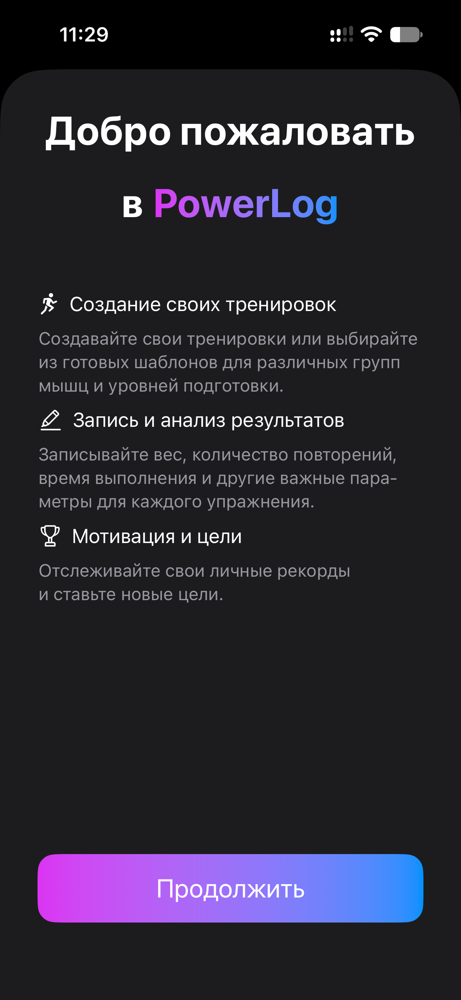
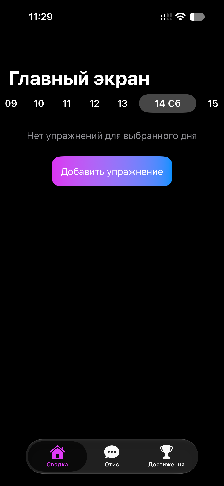
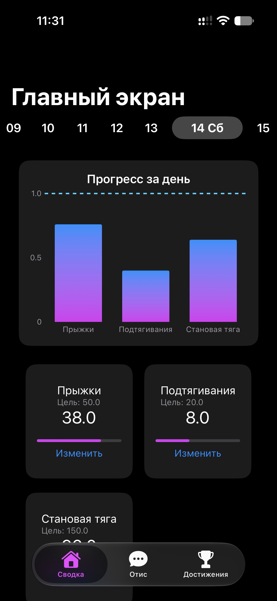
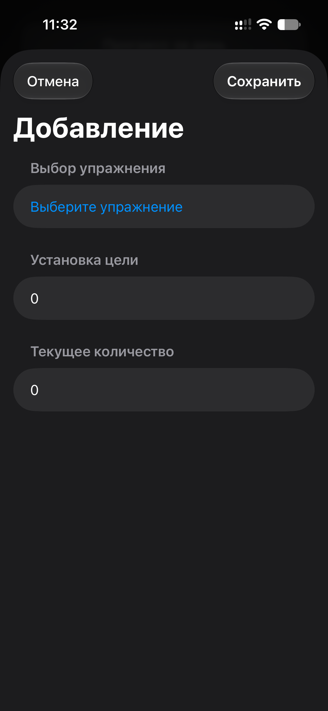
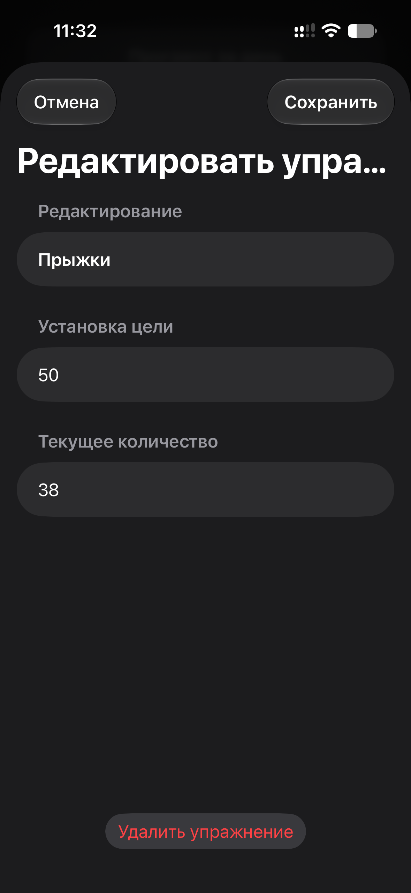
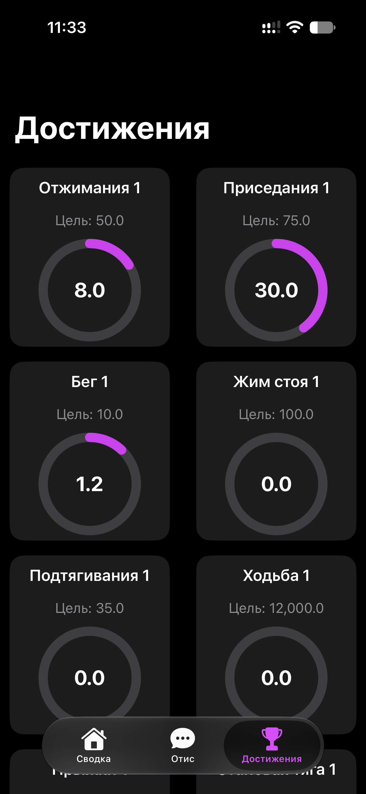
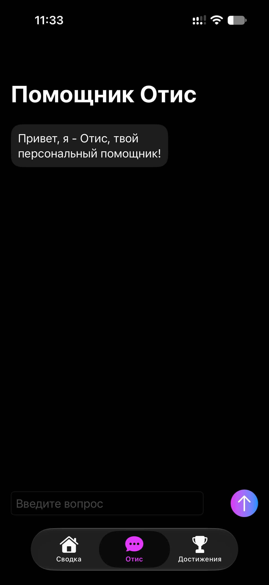

# PowerLog

iOS workout tracker written in SwiftUI. Log exercises for each day, track progress against your goals, and keep an eye on achievements.

**Русская версия: [README.ru.md](README.ru.md)**

---

## Status

Honest current state of the repository: this is the **2024 coursework version** of the app. It works — you can run it and log workouts — but the code is legacy coursework code: functional, not clean, not production quality. A full **PowerLog 2.0 rewrite is in progress** (see [Roadmap](#roadmap)).

A **server-backed build** (Vapor REST API + PostgreSQL, switched via an `#if SERVER` compile flag in a separate Xcode scheme) is **planned but not implemented yet**.

## Screenshots

| | |
|---|---|
| <br>**Welcome / onboarding** | <br>**Main screen, empty day** |
| <br>**Main screen with workouts: week strip, daily progress chart, exercise tiles** | <br>**Add exercise sheet** |
| <br>**Edit / delete exercise sheet** | <br>**Achievements grid** |
| <br>**Otis assistant chat (UI only — see limitations)** | |

## What works now

- Welcome / onboarding screen (shown once, flag stored in `@AppStorage`)
- Week strip on the main screen; tap a day to see its exercises
- Add / edit / delete exercises for a day (built-in list or a custom name), each with a goal and a current value
- "Progress for the day" bar chart (Swift Charts) with a goal line
- Exercise tiles with a progress bar
- Achievements screen: grid of ring-progress tiles, progress entered manually
- Otis assistant chat screen (UI only)

## Known limitations (current version)

- Data lives in `UserDefaults` as JSON (`[Date: [Activity]]`) — **no SwiftData, no iCloud sync, no backup**
- Achievements are **entered by hand**, not calculated from workouts
- **Otis does not answer** — the API keys are empty placeholders; an on-device model is planned for 2.0
- No login, no server, no widgets, no tests
- Code quality is coursework-level (hardcoded values, commented-out blocks, mixed responsibilities)

## Architecture (current version)

```
PowerLogApp            entry point, welcome sheet
└── MainTabView       3 tabs
    ├── MainView      week strip + day list, CRUD sheets (AddWorkout / EditWorkout)
    ├── OtisView      chat UI (not wired to a model yet)
    └── AchievementsView  ring-progress grid, manual progress

Storage: UserDefaults, JSON-encoded [Date: [Activity]]
Model:   Activity (id, title, goal, amount) — plain Codable struct
Charts:  Swift Charts (BarMark + RuleMark on the main screen)
```

Single Xcode target `PowerLog`, Swift 5, SwiftUI, deployment target iOS 18.1.

## Roadmap

Short version:

- **Now** — the legacy app above: log exercises for a day, daily chart, achievements UI
- **Next** — migrate storage to SwiftData (+ iCloud sync); achievements calculated automatically from workouts; a Progress tab with per-exercise charts and personal records
- **Later** — Otis running on-device (Foundation Models, no server, no keys); server-backed build (Vapor + PostgreSQL); localization; widgets / HealthKit

## Requirements & how to run

- Xcode 16+, iOS 18.1+ simulator or device
- Open `PowerLog.xcodeproj`, select the **PowerLog** scheme, run
- No CocoaPods/SPM dependencies, no test target

## Tech stack

- **Now:** Swift 5, SwiftUI, Swift Charts, `UserDefaults`
- **Planned:** SwiftData + CloudKit sync, Foundation Models (on-device LLM), Vapor + PostgreSQL for the server build

## History

Started in 2024 as a coursework project. The 2.0 rewrite started in 2026.
