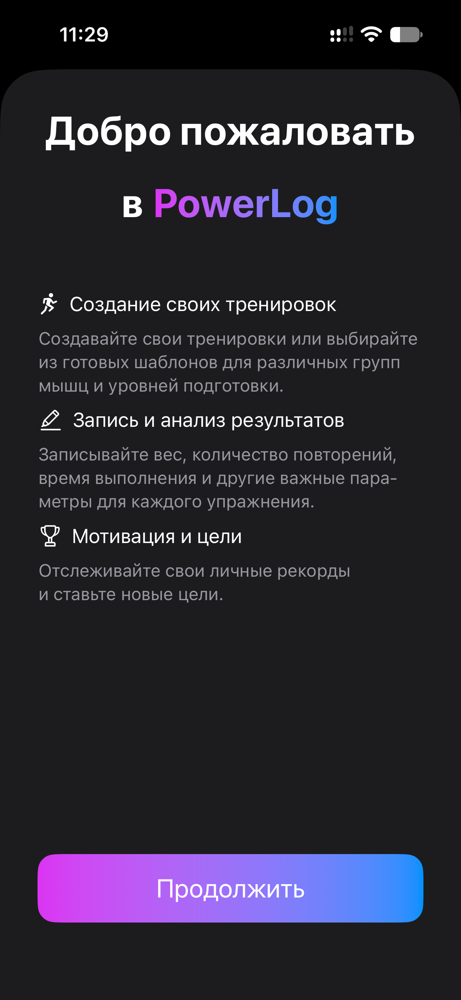
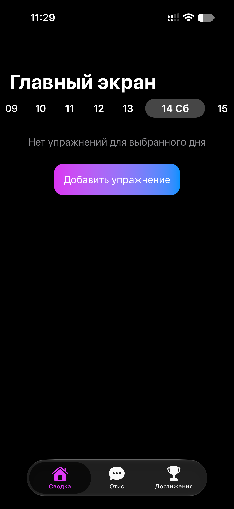
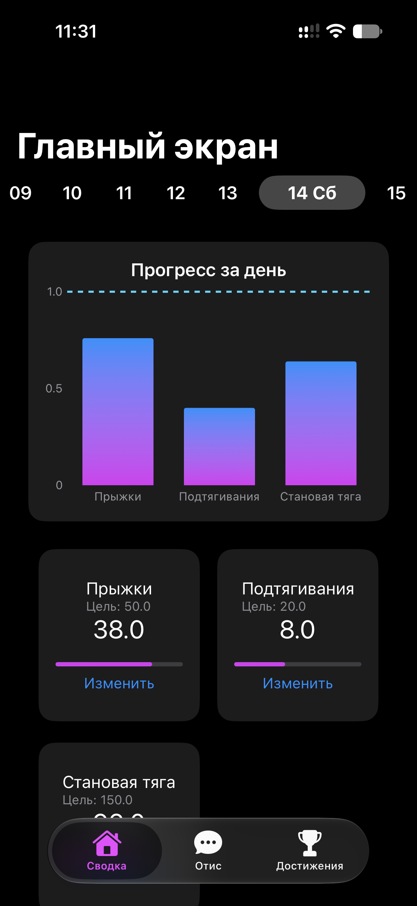
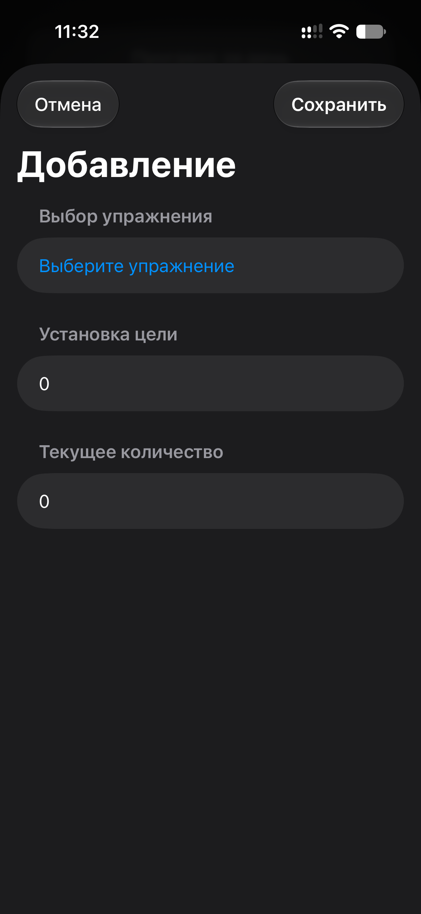
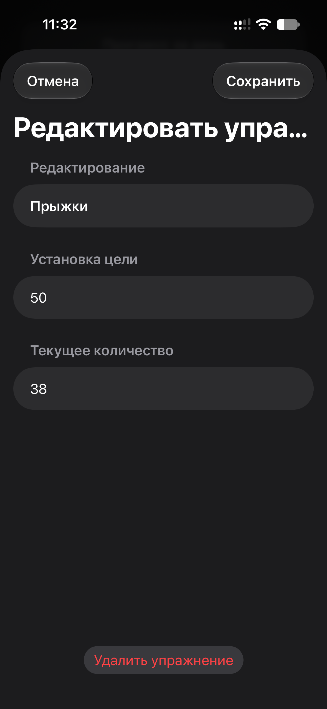
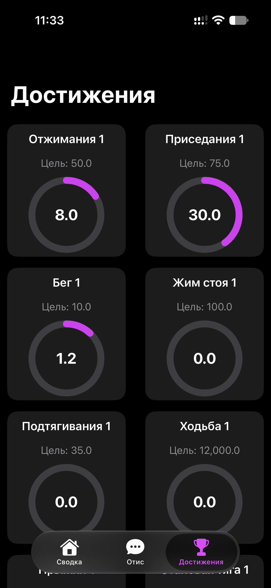
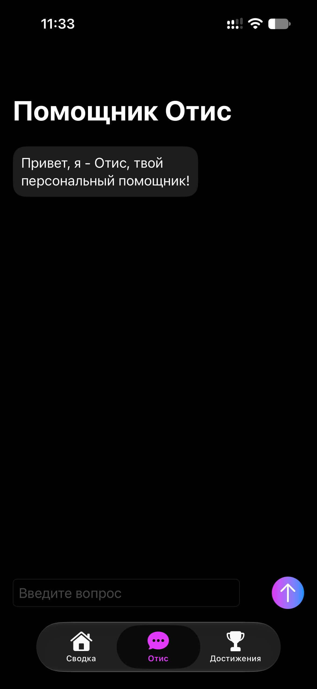

# PowerLog

Трекер тренировок для iOS на SwiftUI. Записывай упражнения по дням, следи за прогрессом к целям и достижениями.

**English version: [README.md](README.md)**

---

## Статус

Честное текущее состояние репозитория: здесь лежит **версия курсовой 2024 года**. Приложение работает — можно запустить и записывать тренировки, — но код унаследован от курсовой: рабочий, но не чистый, не продакшн-уровня. В процессе — полный переписанный **PowerLog 2.0** (см. [Roadmap](#roadmap)).

**Серверная сборка** (REST API на Vapor + PostgreSQL, переключается флагом компиляции `#if SERVER` в отдельной схеме Xcode) **запланирована, но пока не реализована**.

## Скриншоты

| | |
|---|---|
| <br>**Welcome / онбординг** | <br>**Главный экран, пустой день** |
| <br>**Главный экран с тренировками: лента недели, график прогресса за день, плитки упражнений** | <br>**Добавление упражнения** |
| <br>**Редактирование / удаление упражнения** | <br>**Сетка достижений** |
| <br>**Чат с помощником Отисом (только UI — см. ограничения)** | |

## Что работает сейчас

- Welcome-экран при первом запуске (флаг в `@AppStorage`)
- Лента недели на главном экране; тап по дню — упражнения этого дня
- Добавление / редактирование / удаление упражнений дня (из списка или своё название), у каждого цель и текущее значение
- График «Прогресс за день» (Swift Charts) с линией цели
- Плитки упражнений с прогресс-баром
- Экран достижений: сетка колец прогресса, прогресс вводится вручную
- Экран чата с Отисом (только UI)

## Известные ограничения (текущая версия)

- Данные в `UserDefaults` в виде JSON (`[Date: [Activity]]`) — **нет ни SwiftData, ни синхронизации iCloud, ни бэкапа**
- Достижения **вводятся руками**, а не считаются из тренировок
- **Отис не отвечает** — ключи API пустые; в 2.0 планируется on-device модель
- Нет логина, сервера, виджетов, тестов
- Качество кода — курсовое (захардкоженные значения, закомментированные блоки, смешение ответственности)

## Архитектура (текущая версия)

```
PowerLogApp            точка входа, welcome-sheet
└── MainTabView       3 вкладки
    ├── MainView      лента недели + список дня, CRUD-экраны (AddWorkout / EditWorkout)
    ├── OtisView      UI чата (к модели пока не подключён)
    └── AchievementsView  сетка колец прогресса, ручной ввод

Хранение: UserDefaults, JSON [Date: [Activity]]
Модель:   Activity (id, title, goal, amount) — обычный Codable struct
Графики:  Swift Charts (BarMark + RuleMark на главном экране)
```

Один таргет Xcode `PowerLog`, Swift 5, SwiftUI, deployment target iOS 18.1.

## Roadmap

Коротко:

- **Сейчас** — унаследованное приложение: запись упражнений по дням, график за день, UI достижений
- **Дальше** — переезд на SwiftData (+ синхронизация iCloud); достижения считаются автоматически из тренировок; вкладка «Прогресс» с графиками по упражнениям и личными рекордами
- **Потом** — Отис on-device (Foundation Models, без сервера и ключей); серверная сборка (Vapor + PostgreSQL); локализация; виджеты / HealthKit

## Требования и запуск

- Xcode 16+, симулятор или устройство iOS 18.1+
- Открыть `PowerLog.xcodeproj`, выбрать схему **PowerLog**, запустить
- Зависимостей (CocoaPods/SPM) нет, тестового таргета нет

## Стек

- **Сейчас:** Swift 5, SwiftUI, Swift Charts, `UserDefaults`
- **В планах:** SwiftData + синхронизация CloudKit, Foundation Models (on-device LLM), Vapor + PostgreSQL для серверной сборки

## История

Проект начат в 2024 году как курсовая. Переписывание в 2.0 началось в 2026 году.
